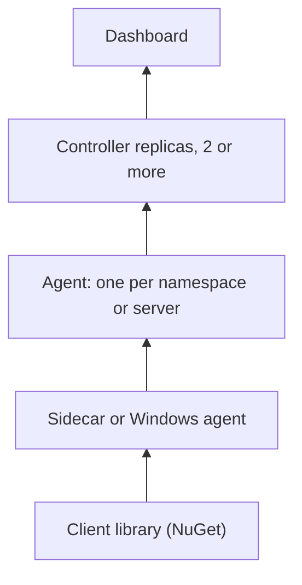

# Plover

A small, stateless, Native AOT monitoring system for .NET 10 workloads on Kubernetes and Windows. It gives you one live dashboard of health, metrics and service dependencies across environments and data centers, with alerting, and without a service mesh or a database.

Connections are always opened from the lower part upward, nothing is written to disk, and any controller replica can be rebuilt from the agents.

If you are new here, read [Start here](start). It takes five minutes and ends with the dashboard running on your machine.

| If you want to | Read |
| --- | --- |
| Know what it is, how the parts fit and how they talk | [Design](design) |
| Look up a word | [Glossary](glossary) |
| Set up the controller, the agents and the sidecars | [Configuration](configuration) |
| Monitor Windows servers | [Windows servers](windows) |
| Run it on OpenShift | [OpenShift](openshift) |
| See how it is tested and how fast it has to stay | [Testing](testing) and [Speed budgets](performance) |
| Change the code | [Contributing](contributing) |
