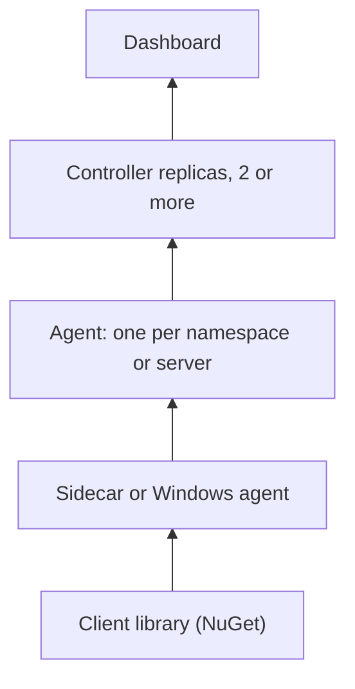

# Monitoring

A small, stateless, Native AOT monitoring system for .NET 10 workloads on Kubernetes and Windows. One live dashboard of health, metrics and service dependencies across environments and data centers, with alerting, and without a service mesh or a database.

Every connection is opened from the lower tier upward, nothing is written to disk, and any controller replica can be rebuilt from the agents alone.

| If you want to | Read |
| --- | --- |
| Know what it is and how the parts fit and talk | [Design](design) |
| Set up and tune the controller, agents and sidecars | [Configuration](configuration) |
| Monitor Windows servers | [Windows servers](windows) |
| Run it on OpenShift | [OpenShift](openshift) |
| See how it is tested and how fast it must stay | [Testing](testing) and [Speed budgets](performance) |
| Change the code | [Contributing](contributing) |
